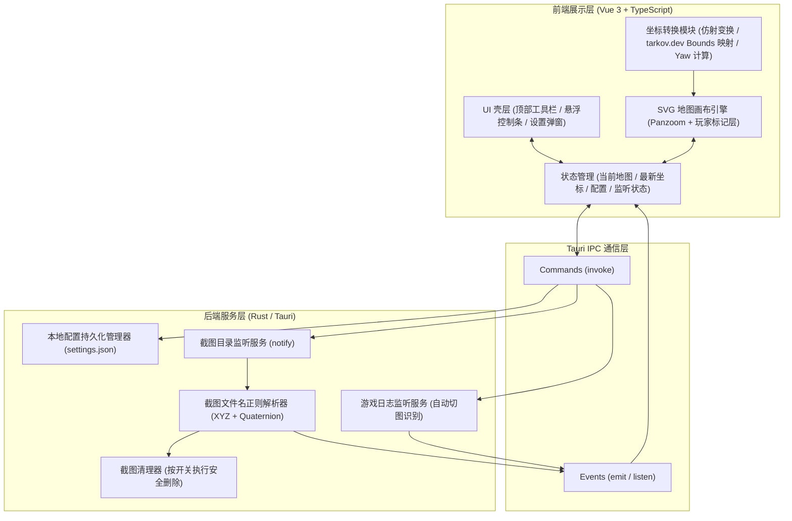

# 架构设计文档（Architecture Design Document）

## 1. 技术栈选型

严格遵循项目规范与桌面端低内存诉求，采用 **Tauri v2 + Vue 3 + TypeScript** 架构：

| 层级 | 选型 | 说明 |
| :--- | :--- | :--- |
| **桌面容器 / 后端** | **Tauri v2 (Rust)** | 负责文件系统监听、截图文件名解析、游戏日志解析、配置持久化与文件清理，内存占用极低。 |
| **Rust 核心依赖** | `notify`、`regex`、`serde` / `serde_json`、`tokio` | 跨平台异步文件事件监听、正则提取坐标、JSON 配置序列化。 |
| **前端框架** | **Vue 3 (Composition API) + TypeScript 5.x** | 强类型开发体验，逻辑复用清晰。 |
| **构建与包管理** | **Vite + pnpm** | 极速热更新与高效依赖管理。 |
| **UI 组件库** | **Element Plus（Dark Mode）** | 配合暗黑战术风 CSS 变量定制下拉框、开关、弹窗、提示等控件。 |
| **SVG 交互引擎** | **`@panzoom/panzoom`（或 `d3-zoom`）** | 高性能平滑拖拽平移、以鼠标为中心的滚轮缩放与坐标居中动画。 |
| **地图数据源** | **`tarkov.dev` 地图资源与元数据** | 内置或在线同步 `tarkov.dev` 官方全地图 SVG 及对应的坐标校准参数（`bounds` / `coordinateRotation`）。 |

---

## 2. 系统分层与模块划分



### 2.1 Rust 后端模块
1. **Config Manager**：管理本地 `settings.json`（截图目录、日志目录、自动删除开关、自动切图开关、上次地图）。启动时自动探测默认截图目录 `%USERPROFILE%\Documents\Escape from Tarkov\Screenshots`。
2. **Screenshot Watcher**：使用 `notify` 监听截图目录的 `Create` 事件（带防抖与文件写入就绪检查，过滤非 `.png` 文件）。
3. **Screenshot Parser**：使用正则提取文件名中的 `(x, y, z)` 与四元数 `(qx, qy, qz, qw)`，通过 Tauri Event `screenshot-coord` 推送给前端。若开启自动删除，则在发送事件后异步安全删除该截图文件。
4. **Log Watcher**：监听塔科夫 `Logs` 目录最新日志文件追加内容，匹配进图日志行（如 `Location` / 地图 `nameId`），推送 `map-detected` 事件给前端。

### 2.2 前端模块
1. **Map Registry & SVG Loader**：维护全官方地图元数据列表（中文名、英文名、`tarkov.dev` 地图 ID、SVG 文件路径、坐标映射参数）。
2. **Coordinate Transform Engine**：
   - 将游戏世界坐标 `(X, Z)` 转换为 SVG 视图坐标 `(svgX, svgY)`（支持 `tarkov.dev` 的 `bounds` 线性边界映射及通用 2D 仿射变换矩阵）。
   - 将四元数 `(qx, qy, qz, qw)` 转换为水平偏航角 `yawDeg`，叠加地图 `coordinateRotation` 补偿角，得到地图上的真实朝向角度。
3. **SVG Map Canvas**：加载 SVG 地图并在顶层渲染玩家标记（红点 + 视野扇形 + 脉冲动效），支持缩放反向补偿（确保标记大小随缩放保持清晰）。

---

## 3. 目录结构设计

```text
tkfmap/
├── src/                          # Vue 3 + TS 前端源码
│   ├── assets/
│   │   ├── maps/                 # 从 tarkov.dev 获取的全官方地图 SVG 资源
│   │   └── styles/               # 暗黑战术风全局样式与 Element Plus 主题覆盖
│   ├── components/
│   │   ├── TopToolbar.vue        # 顶部紧凑工具栏（选图、坐标、状态灯、设置入口）
│   │   ├── MapCanvas.vue         # 全画幅 SVG 渲染 + Panzoom + 玩家定位标记
│   │   ├── MapControls.vue       # 右下角悬浮控制条（放大/缩小/居中/重置）
│   │   └── SettingsModal.vue     # 设置弹窗（路径配置、自动删除开关等）
│   ├── composables/
│   │   ├── useTauriEvents.ts     # 封装 Tauri 事件监听与生命周期清理
│   │   └── useMapTransform.ts    # 坐标映射与四元数偏航角计算
│   ├── data/
│   │   └── maps.config.ts        # 全官方地图元数据与 tarkov.dev 校准参数
│   ├── types/
│   │   └── index.ts              # 统一 TypeScript 类型定义
│   ├── App.vue
│   └── main.ts
├── src-tauri/                    # Rust Tauri 后端源码
│   ├── src/
│   │   ├── main.rs               # 入口
│   │   ├── lib.rs                # Tauri Builder 与 Command 注册
│   │   ├── config.rs             # 配置读写与默认路径探测
│   │   ├── parser.rs             # 截图文件名正则解析（含单元测试）
│   │   ├── watcher.rs            # 截图目录与游戏日志监听
│   │   └── types.rs              # 跨端数据结构定义
│   ├── Cargo.toml
│   └── tauri.conf.json           # 窗口配置（普通桌面窗口，非置顶）
├── package.json
├── tsconfig.json
└── vite.config.ts
```

---

## 4. Tauri IPC API 契约定义

### 4.1 Frontend -> Backend Commands (`invoke`)

| Command 名称 | 请求参数 | 返回类型 | 说明 |
| :--- | :--- | :--- | :--- |
| `get_settings` | 无 | `AppSettings` | 获取当前持久化配置及路径有效性状态 |
| `save_settings` | `settings: AppSettings` | `Result<WatcherStatus, String>` | 保存配置并重启文件监听器 |
| `detect_default_paths` | 无 | `DetectedPaths` | 自动探测默认截图目录与游戏日志目录 |
| `get_watcher_status` | 无 | `WatcherStatus` | 查询当前截图/日志监听运行状态 |

### 4.2 Backend -> Frontend Events (`emit`)

| Event 名称 | Payload 结构 | 说明 |
| :--- | :--- | :--- |
| `screenshot-coord` | `{ x: number, y: number, z: number, qx: number, qy: number, qz: number, qw: number, filename: string, timestamp: number }` | 检测到新截图并成功解析坐标时触发 |
| `map-detected` | `{ mapId: string, rawLocation: string }` | 从游戏日志识别到进入新战局地图时触发 |
| `watcher-error` | `{ target: 'screenshot' \| 'log', message: string }` | 监听目录失效或权限异常时触发 |

### 4.3 核心数据结构（TypeScript / Rust 对齐）

```typescript
export interface AppSettings {
  screenshotDir: string;
  logsDir: string;
  autoDeleteScreenshot: boolean; // 默认 false
  autoSwitchMapByLog: boolean;   // 默认 true
  autoCenterOnCoord: boolean;    // 默认 true
  lastSelectedMapId: string;
}

export interface WatcherStatus {
  screenshotWatching: boolean;
  screenshotError?: string;
  logWatching: boolean;
  logError?: string;
}
```

---

## 5. 一致性校验

- **需求对齐**：完全覆盖 `requirement.md` 中 P0 全部功能（全官方地图、`tarkov.dev` SVG 对接、截图监听与朝向、手动+日志切图、可选自动删除截图、普通窗口形态）。
- **UI/UX 对齐**：IPC 状态与前端 `TopToolbar`、`MapCanvas`、`MapControls`、`SettingsModal` 一一对应。
- **合规性**：Rust 后端仅操作文件系统 `notify` 与文本正则，不涉及任何进程或内存 API。
